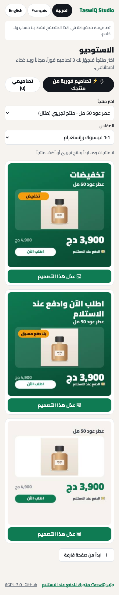
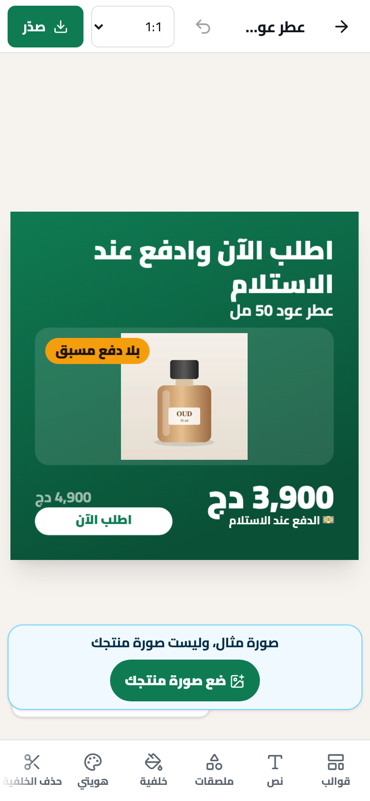
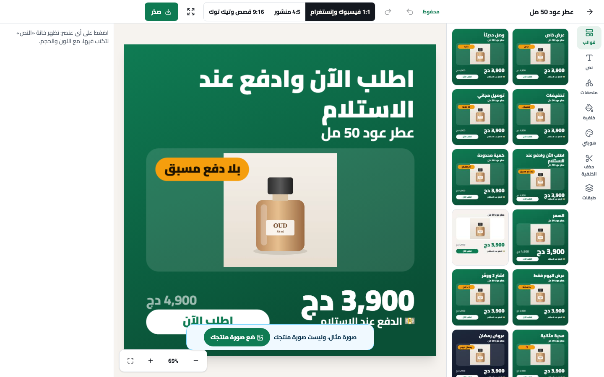

# TaswiQ Design Studio

[العربية](#العربية) · [English](#english)

<p align="center">
  
</p>

---

## العربية

**استوديو TaswiQ للتصميم** يصنع إعلاناً لمنتجك في دقائق، داخل المتصفح. العربية هي اللغة الأولى، ويعمل أيضاً بالفرنسية والإنجليزية.

- **3 تصاميم فورية من منتجك:** اسمه وسعره وصورته في قوالب جاهزة لفيسبوك وإنستغرام والقصص (1:1 و4:5 و9:16).
- **15 قالباً،** مع هوامش آمنة وتنبيه حين يضعف وضوح النص وزر «أصلح تلقائياً».
- **حذف الخلفية داخل متصفحك:** نموذج u2netp، فلا تخرج الصورة من جهازك.
- **التحرير:** نص بخطوط عربية مفتوحة، وألوان، وطبقات، وتراجع وإعادة، وتكبير وتصغير، وواجهة مخصصة للهاتف.
- **التصدير:** PNG أو JPG، وكل المقاسات دفعة واحدة، ومشاركة على واتساب.
- **النسخة المستقلة بلا حساب ولا خادم:** تصاميمك محفوظة في هذا المتصفح فقط (IndexedDB).

> **جرّب TaswiQ:** متجرك للدفع عند الاستلام في الجزائر، وفيه هذا الاستوديو مرتبطاً بمنتجاتك → **[taswiq.store](https://taswiq.store)**

<p align="center">
  
  
</p>
<p align="center"></p>

### التشغيل محلياً

يحتاج Node.js 22 أو أحدث.

```sh
npm ci
npm run dev        # http://localhost:5173
```

### البناء والفحص

```sh
npm run typecheck  # فحص الأنواع
npm test           # الاختبارات
npm run build      # التطبيق المستقل في dist/
```

`dist/` موقع ثابت يُرفع إلى أي استضافة. اخدم `*.wasm` بالنوع `application/wasm`.

### كيف يُستعمل داخل تطبيق آخر

الحزمة مصدر TypeScript واحد. يستعمله TaswiQ والنسخة المستقلة معاً، عبر «محوّلات» للتخزين والصور والمنتجات والهوية والذكاء الاصطناعي. انظر `src/context.tsx`، ومثالاً كاملاً في `app/local.ts`.

```tsx
import { Studio, StudioProvider } from "@taswiq/design-studio";
<StudioProvider host={myHost}><Studio /></StudioProvider>
```

### المساهمة

نرحب بكل مساهمة. اقرأ [CONTRIBUTING.md](CONTRIBUTING.md): كل تغيير يحتاج اختباراً، ويمر بفحص الأنواع والبناء وgitleaks. وقّع [اتفاقية المساهمة](CLA.md) مرة واحدة في أول طلب دمج.

### الرخصة

**AGPL-3.0** (انظر `LICENSE`). إن عدّلت الاستوديو وقدّمته لغيرك عبر الشبكة، فشارك تعديلاتك بالرخصة نفسها. رخص المكونات المأخوذة كلها في `NOTICE`.

---

## English

**TaswiQ Design Studio** makes an ad for your product in minutes, in the browser. Arabic comes first, and it also works in French and English.

- **3 instant designs from your product:** its name, price and photo in ready templates for Facebook, Instagram and stories (1:1, 4:5, 9:16).
- **15 templates,** with safe margins, a warning when text gets hard to read, and a "fix automatically" button.
- **Background removal in your browser:** the u2netp model, so your picture never leaves your device.
- **Editing:** text in open Arabic fonts, colours, layers, undo and redo, zoom, and a layout made for phones.
- **Export:** PNG or JPG, every size at once, and WhatsApp sharing.
- **The standalone app has no account and no server:** your designs stay in this browser only (IndexedDB).

> **Try TaswiQ:** your cash-on-delivery store in Algeria, with this studio connected to your products → **[taswiq.store](https://taswiq.store)**

### Run it locally

Requires Node.js 22 or newer.

```sh
npm ci
npm run dev        # http://localhost:5173
```

### Build and check

```sh
npm run typecheck
npm test
npm run build      # the standalone app in dist/
```

`dist/` is a static site that any host can serve. Serve `*.wasm` as `application/wasm`.

### Use it inside another app

The package is one TypeScript source that both TaswiQ and the standalone app use. Hosts plug in "adapters" for storage, pictures, products, brand and AI. See `src/context.tsx`, and `app/local.ts` for a complete example.

```tsx
import { Studio, StudioProvider } from "@taswiq/design-studio";
<StudioProvider host={myHost}><Studio /></StudioProvider>
```

### Contributing

Contributions are welcome; see [CONTRIBUTING.md](CONTRIBUTING.md). Every change needs a test and must pass typecheck, build and gitleaks. Sign the [Contributor License Agreement](CLA.md) once, on your first pull request.

### License

**AGPL-3.0** (see `LICENSE`). If you change the studio and offer it to others over a network, you must share your changes under the same license. Every third-party component and its license is listed in `NOTICE`.
